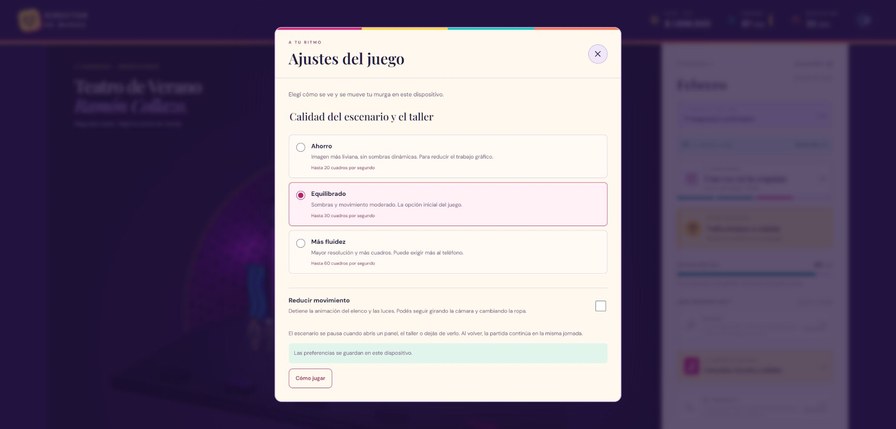

# QA v10: ajustes gráficos y pausas del 3D

Fecha: **14 de octubre de 2026**. Plataforma de verificación: Windows, Chrome, Vite en `http://localhost:5174/`. Revisión de escritorio y del panel de ajustes a **390 × 844 píxeles CSS** mediante viewport del navegador. No se usó un teléfono físico ni un emulador Android/iOS.

## Entrega

- Ajustes Ahorro, Equilibrado y Más fluidez para escenario y taller; límites de 20/30/60 FPS, densidad máxima 1/1,25/1,5 y sombras desactivadas en Ahorro.
- Preferencia de movimiento reducido combinada con `prefers-reduced-motion` del sistema. Se detienen animaciones continuas, manteniendo cámara, ropa y selección de poses.
- El escenario suspende su bucle cuando un diálogo lo cubre, sale de vista, el documento queda oculto o se pierde el contexto WebGL. El taller suspende su trabajo al quedar oculto o fuera de vista.
- Guardado independiente en `director-de-murga-visual-settings-v1`; campaña y clave de partida permanecen en v9.

Los FPS son topes de planificación; no se midió que un dispositivo alcance esas tasas ni se cuantificó consumo de batería. La instrumentación DOM cuenta dibujos efectivos, no cuadros estimados.

## Pruebas automáticas y compilación

`npm test`: **85 aprobadas, 0 fallos** (67 de simulación, 14 de personajes y 4 de política visual). Los casos nuevos cubren preferencias malformadas, campos independientes, densidades inválidas, cadencia a distintas frecuencias de pantalla, pausa/reanudación y descarte de cuadros atrasados.

`npm run mobile:sync`: **correcto** en el estado final; incluye TypeScript, build de Vite y copia/actualización de Android e iOS. Vite mantiene el aviso por un fragmento mayor a 500 kB: JavaScript principal de 901,08 kB, 252,34 kB gzip. No es un fallo de compilación, pero la carga y el rendimiento deben medirse en los teléfonos objetivo.

No se generó ni instaló un APK, AAB o IPA en esta entrega.

## Recorrido de navegador

La partida existente era La Vereda, temporada 3, jornada 29/32, caja UYU 1.936.200, energía 87 y reputación 32. Se revisaron ajustes y propuestas de vestuario sin comprar confección ni avanzar jornadas. Esos valores y los 17 integrantes se conservaron tras recargar y al finalizar.

| Caso | Evidencia observada |
| --- | --- |
| Preferencias persistentes | Ahorro y movimiento reducido permanecieron seleccionados tras recargar. Al finalizar se dejó Equilibrado con la reducción manual desactivada. |
| Panel sobre el escenario | Con ajustes abiertos, `data-render-state=paused`; el contador de dibujos permaneció en 6 entre observaciones. |
| Cámara en movimiento reducido | Al cerrar ajustes hubo un dibujo estático; acercar la cámara produjo otro sin iniciar animación continua. |
| Perfiles | Ahorro expuso límite 20 y densidad 1; Más fluidez, límite 60 y densidad 1,25 en esta pantalla; Equilibrado, límite 30 y densidad 1,25. Se respetó la densidad del dispositivo por debajo del máximo. |
| Taller sobre escenario | Al abrir una propuesta gratuita, el escenario quedó pausado y el taller utilizó el perfil seleccionado. Al cerrar se recuperó el panel de propuestas. |
| Fuera de pantalla | En viewport móvil, al desplazar el escenario por encima del área visible el contador quedó fijo en 1.883. Al volver, el estado fue `running` y el contador avanzó. |
| Pose estática del taller | Con reducción activa, Reproducir quedó deshabilitado. Brazos arriba mostró una pose con brazos levantados y quedó quieta. Cambiar pose y comparar personajes siguió funcionando. |
| Redibujado con límite | Tras corregir el acceso de cámara al planificador, Ahorro con pose estática pasó de 3 a 4 dibujos al acercar; seleccionar Brazos arriba produjo el quinto, conservando estado `still`. La inspección de código confirma que las peticiones pendientes esperan al presupuesto de cuadros. No se midió una tasa sostenida de arrastre. |
| Panel móvil | Ancho CSS de documento y viewport: 390; no hubo desborde horizontal. Tarjetas de calidad de unos 317 × 118 px y controles principales con área de al menos 44 px. Captura revisada visualmente. |
| Recarga y consola | Tras recargar, la partida conservó sus valores y la consulta de errores/advertencias capturados devolvió una lista vacía. |

La captura del taller con la anulación de viewport del navegador salió reducida incorrectamente aunque su geometría DOM era correcta; se restableció el viewport y se inspeccionó la pose en escritorio. No se presenta esa captura fallida como validación visual móvil del taller. El viewport quedó restablecido al terminar.

## Límites y pruebas pendientes

- No se forzó la preferencia de movimiento del sistema ni una pérdida/restauración de contexto en este recorrido. Sus listeners y limpieza se revisaron en código.
- Abrir otra pestaña automatizada no cambió `document.hidden` en este entorno, por lo que ese intento no acredita pausa por segundo plano. Sigue pendiente comprobarla al bloquear/suspender una app instalada.
- Faltan pruebas físicas de temperatura, batería, fluidez, áreas seguras, interrupciones y guardado tras cerrar el proceso, además de arranque sin red y actualización de una instalación.
- El entorno local tiene Java 11.0.30; falta configurar JDK 21 y Android SDK. Gradle 8.14.3 ya está en caché. Android Studio y herramientas SDK no se localizaron en las ubicaciones habituales. iOS necesita macOS/Xcode y configuración de firma. El splash iOS conserva la plantilla de Capacitor.
- No se consultaron nuevas tarifas ni se verificó la fidelidad económica mediante personas del carnaval en esta entrega. El plan concreto de beta está en [BETA-PENDIENTES.md](BETA-PENDIENTES.md).
